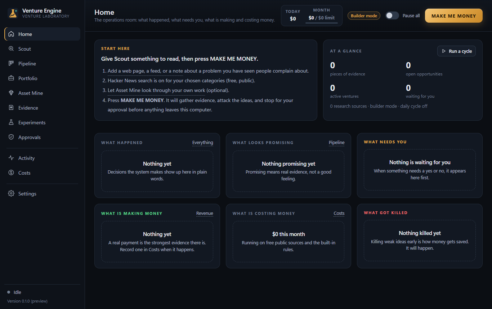
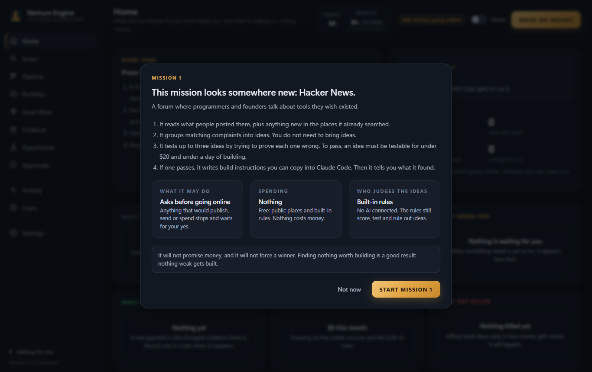
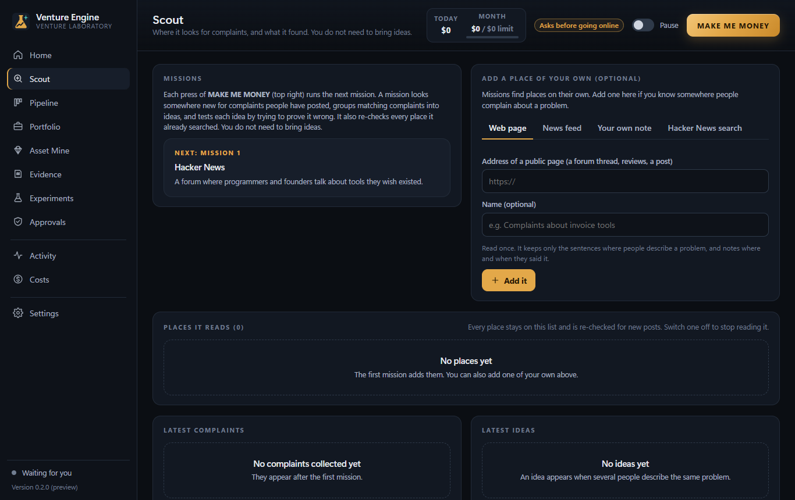
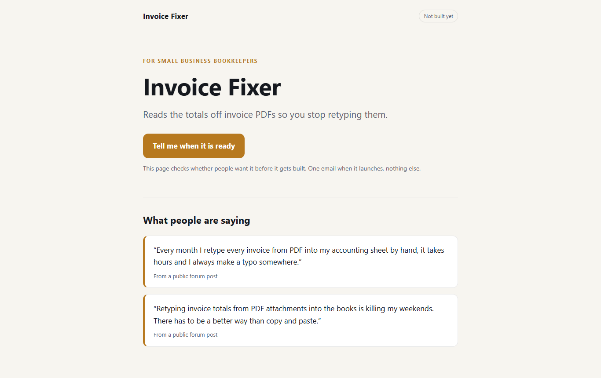
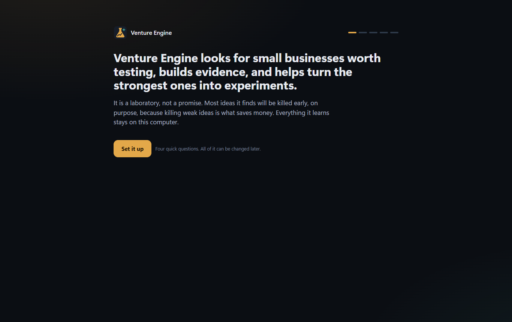
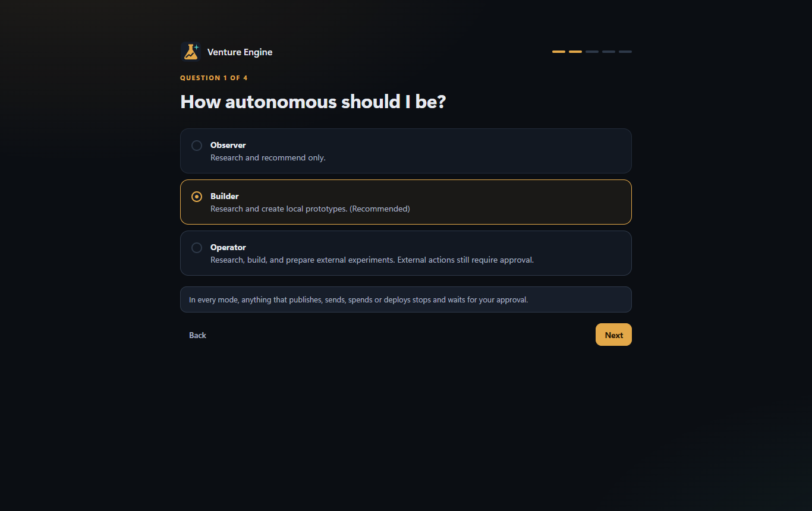
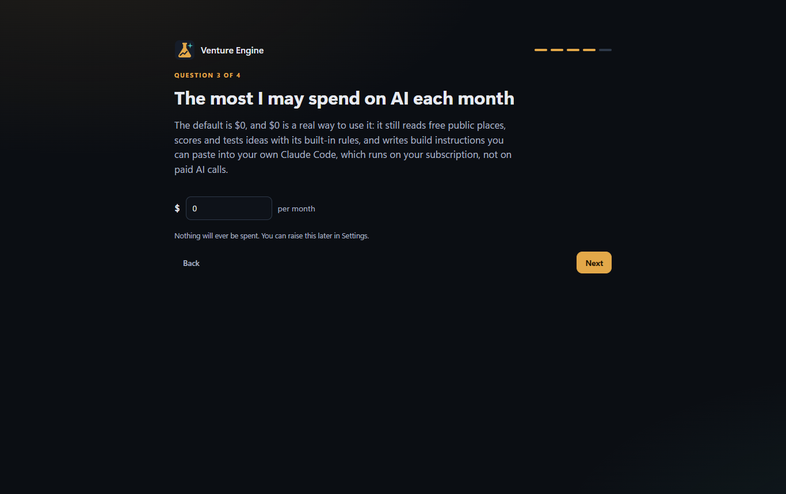

# Venture Engine

### A laboratory for small businesses, not a promise.

Venture Engine is a Windows app that looks for small businesses worth testing, builds evidence, and helps turn the strongest ones into experiments. **Most ideas it finds are killed early, on purpose, because killing weak ideas is what saves money.** Everything it learns stays on the computer.

## Missions

One button. Each press of **MAKE ME MONEY** runs the next mission, and every mission looks somewhere it has not looked before. Nobody has to bring ideas.

* **Mission 1** reads Hacker News. **Missions 2 to 8** read places where people talk about the tools they pay for: Reddit groups for small business owners, online sellers, tradespeople, creators, office workers and teachers; App Store reviews of paid work apps; question-and-answer sites where people ask "is there a program that does this?"; and reviews of popular WordPress plugins. Every one of those addresses was loaded and checked before it shipped.
* **After that, Claude suggests new places**, and the app keeps only the addresses that actually load and turn up real complaints. Without AI, a mission re-checks the places already searched, and says so.
* **Every place stays on the list** and is re-checked for new posts, so nothing is lost by moving on. A mission reads every address of its new place; if a site does not answer, it tries again, and if part of the place still could not be read, the next mission goes back to it once.
* **Ideas that need more proof get looked up on purpose.** Every mission searches for up to ten of them, taking turns, half of them ideas you picked yourself. With Claude connected, each search is aimed at what the idea is missing, such as people who pay for a fix. An idea only uses up one of its checks when it is actually looked up.
* **Every mission uses the same test**: an idea must be testable for under $20 and under a day of building. Up to three ideas are tested by trying to prove each one wrong; at most one advances.
* **The report is plain English**: where it looked, how many complaints it found, why each idea was ruled out, and where the next mission will look.

## The test page it makes

When an idea passes, it gets a plain one-page test: real complaints first (no names), how it would work, the planned price, and a sign-up box. Example content shown.

## The loop

Complaint, idea, test, venture, experiment, approval, result. Then keep going, change course, or stop, and go round again.

* **The Evidence Ledger** links every score to the quotes behind it, with a link to where each person said it. Guesses are marked and never counted as proof.
* **Claude has to agree before anything becomes a venture.** The built-in rules are only a first filter; if Claude cannot check an idea, it waits for the next mission rather than passing.
* **The test** kills early, with its reasons in plain words. "Only one person says this." "Nobody has said they would pay."
* **Build instructions for Claude Code:** an idea that survives comes with a complete build brief, copied with one click.

## You set how far it goes

<table>
<tr>
<td width="50%"></td>
<td width="50%"></td>
</tr>
</table>

Research only. Research and build on this computer. Or also get tests ready to go online. **Whichever you pick, anything that would publish, send or spend stops and waits for your yes**, and a yes covers exactly the version you saw, once.

## Money safety

* **Every limit starts at $0**, and $0 is a real way to use it: free public places, the built-in rules, and build briefs you paste into the Claude Code you already pay for.
* Money is set aside before anything is spent. The cost meter labels every figure ESTIMATE or ACTUAL, and says unknown where nothing was measured.
* AI providers (Claude, OpenAI, Gemini, local models) are optional. Keys live in Windows Credential Manager, with a monthly limit and a permission for each task.
* **It never moves money itself.** Revenue and bills are entered by hand.

## Honest about what does not work yet

* **Nothing goes online yet.** Saying yes to a publish saves the page on the computer, with buttons to open it; no hosting is connected yet.
* **Payment platforms are not read**, so revenue is typed in by hand.
* **Without an AI key, judgement is blunt.** It kills most ideas, and titles are plain.
* **Apple's review lists sometimes come back empty for a while**, so they are a bonus place to look, not the backbone.
* **The installer is unsigned**, so Windows shows a warning on first launch.

## Status

Version 0.3.4, for Windows. 143 automated tests (the full loop among them, on a real database file, and seventeen for missions and look-ups), a walkthrough of the real screens, and every built-in mission address checked live before release. The screenshots here come from a fresh, empty profile.

The code is private.

---

**Built by Greygray with AI collaboration openly included in the process.**

Human judgment stays in the driver's seat.
